<p align="center">
  
</p>

<p align="center">
  
</p>

<p align="center">
  <a href="https://www.linkedin.com/in/satyajit06/"></a>
  <a href="mailto:satyajitgr9@gmail.com"></a>
  <a href="https://github.com/Satyajit-147/Satyajit-147/blob/main/Satyajit_S_Resume.pdf"></a>
</p>



Third-year **Computer Science** student at the **Indian Institute of Information Technology, Design and Manufacturing Kancheepuram (IIITDM Kancheepuram)**, and I spend most of my time convincing robots to do things. Some days that's an arm learning a task from a handful of human demos, some days it's an RL agent crashing into maze walls until it stops crashing into maze walls.


**Robotics and physical AI.** Language models got smart in a text box; I want that kind of intelligence in things with motors, grippers and LiDARs that have to deal with gravity, friction and the real world. The bit I chase most is generalisation: a robot that learns from a few demos and still copes when you move the cup.


<table>
  <tr>
    <td width="50%" valign="top">
      <h4><a href="https://github.com/Satyajit-147/VLA-Based-Bimanual-Collaborative-Stacking">🦾 VLA-Based Bimanual Collaborative Stacking</a></h4>
      <b>Two arms, one stack</b>
      <p>A pair of SO-101 arms working together to stack objects, driven by vision-language-action policies trained on teleoperated demos in LeRobot.</p>
      <b>Highlights</b>
      <ul>
        <li>Collected expert demonstration datasets through teleoperation</li>
        <li>Trained and pitted ACT, SmolVLA, π0 and GR00T against each other</li>
        <li>Ran on real hardware, not just in sim</li>
      </ul>
      <b>Tech Stack:</b> LeRobot, PyTorch, ACT, SmolVLA, π0, GR00T
    </td>
    <td width="50%" valign="top">
      <h4><a href="https://github.com/Satyajit-147/TD3-AutoNav">🧭 TD3-AutoNav</a></h4>
      <b>A TurtleBot that learned mazes on its own</b>
      <p>A TD3 agent that drives a TurtleBot3 through Gazebo mazes using only LiDAR scans and where the goal is relative to it.</p>
      <b>Highlights</b>
      <ul>
        <li>BFS geodesic reward shaping so it stops hugging dead ends</li>
        <li>Trained on one maze, handles layouts it has never seen</li>
        <li>~98% success on the training map</li>
      </ul>
      <b>Tech Stack:</b> ROS 2 Humble, Gazebo, Stable-Baselines3, Gymnasium
    </td>
  </tr>
  <tr>
    <td colspan="2" valign="top">
      <h4><a href="https://github.com/Satyajit-147/grayscale2rgb">🎨 grayscale2rgb</a></h4>
      <b>Diffusion brings old faces back to colour</b>
      <p>Colourises grayscale face images with a Denoising Diffusion Probabilistic Model and a custom UNet conditioned on the grayscale input.</p>
      <b>Highlights</b>
      <ul>
        <li>Classifier-free guidance during sampling for richer colour</li>
        <li>Pretrained checkpoint and a notebook to try it locally</li>
      </ul>
      <b>Tech Stack:</b> PyTorch, DDPM, UNet
    </td>
  </tr>
</table>


<h4 align="center">Robotics & Simulation</h4>
<table align="center">
  <tr>
    <td align="center" width="96"><br/><sub>ROS 2</sub></td>
    <td align="center" width="96"><br/><sub>Motion Planning</sub></td>
    <td align="center" width="96"><br/><sub>Navigation</sub></td>
    <td align="center" width="96"><br/><sub>Simulation</sub></td>
    <td align="center" width="96"><br/><sub>Physics Sim</sub></td>
    <td align="center" width="96"><br/><sub>Robot Learning</sub></td>
  </tr>
</table>

<h4 align="center">AI & Computer Vision</h4>
<table align="center">
  <tr>
    <td align="center" width="96"><br/><sub>PyTorch</sub></td>
    <td align="center" width="96"><br/><sub>TensorFlow</sub></td>
    <td align="center" width="96"><br/><sub>OpenCV</sub></td>
    <td align="center" width="96"><br/><sub>scikit-learn</sub></td>
    <td align="center" width="96"><br/><sub>Stable-Baselines3</sub></td>
    <td align="center" width="96"><br/><sub>Detection</sub></td>
  </tr>
</table>

<h4 align="center">Languages & Tools</h4>
<table align="center">
  <tr>
    <td align="center" width="96"><br/><sub>Python</sub></td>
    <td align="center" width="96"><br/><sub>C++</sub></td>
    <td align="center" width="96"><br/><sub>C</sub></td>
    <td align="center" width="96"><br/><sub>Linux</sub></td>
    <td align="center" width="96"><br/><sub>Docker</sub></td>
    <td align="center" width="96"><br/><sub>Git</sub></td>
  </tr>
</table>



<p align="center">
  
</p>

<p align="center">
  
  
</p>

<p align="center">
  
  
</p>


```python
satyajit = {
    "studying":      "B.Tech CSE @ IIITDM Kancheepuram",
    "obsessed_with": ["Physical AI", "Robotic Manipulation", "Imitation Learning",
                      "Vision-Language-Action Models", "Reinforcement Learning", "World Models"],
    "building_with": ["ROS 2", "MoveIt 2", "LeRobot", "PyTorch", "Gazebo", "MuJoCo"],
    "open_to":       "robotics internships and research collabs",
    "fuel":          "coffee and failed rollouts",
}
```



Always up for talking robots, RL papers, or anything with a motor in it. If you're working on robot learning, or just have a cool robot video, send it my way.

<p align="center">
  <a href="https://www.linkedin.com/in/satyajit06/"></a>
  <a href="mailto:satyajitgr9@gmail.com"></a>
  
</p>

<p align="center">
  
</p>
